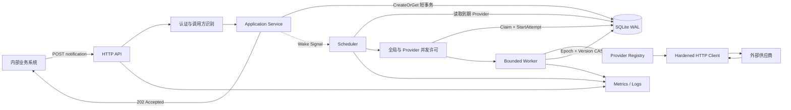
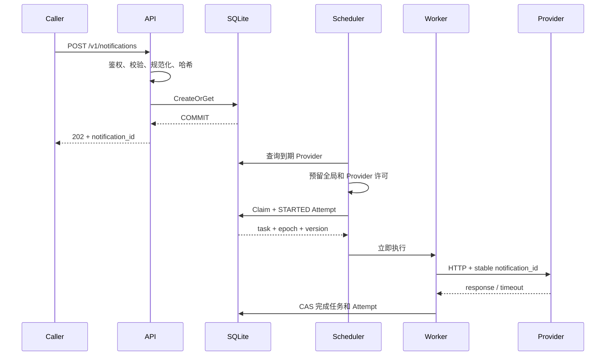
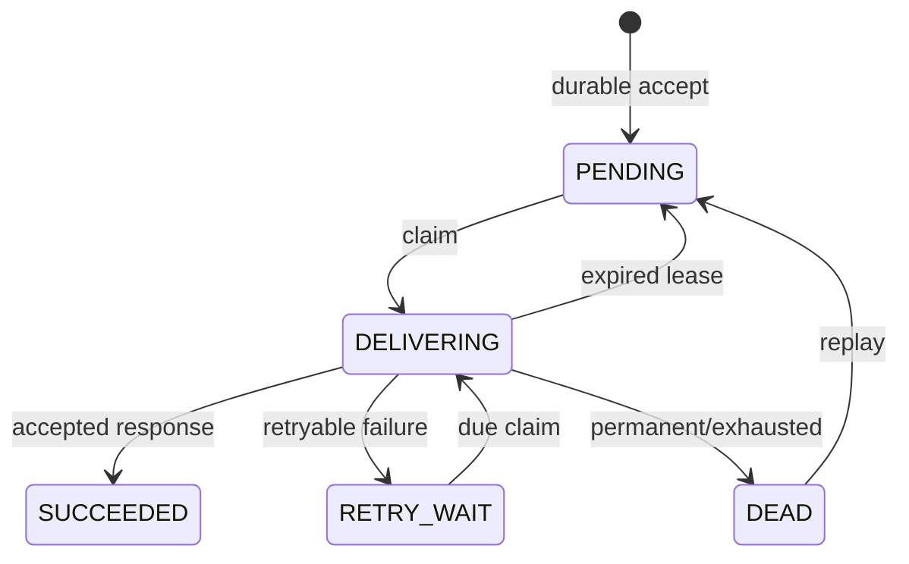
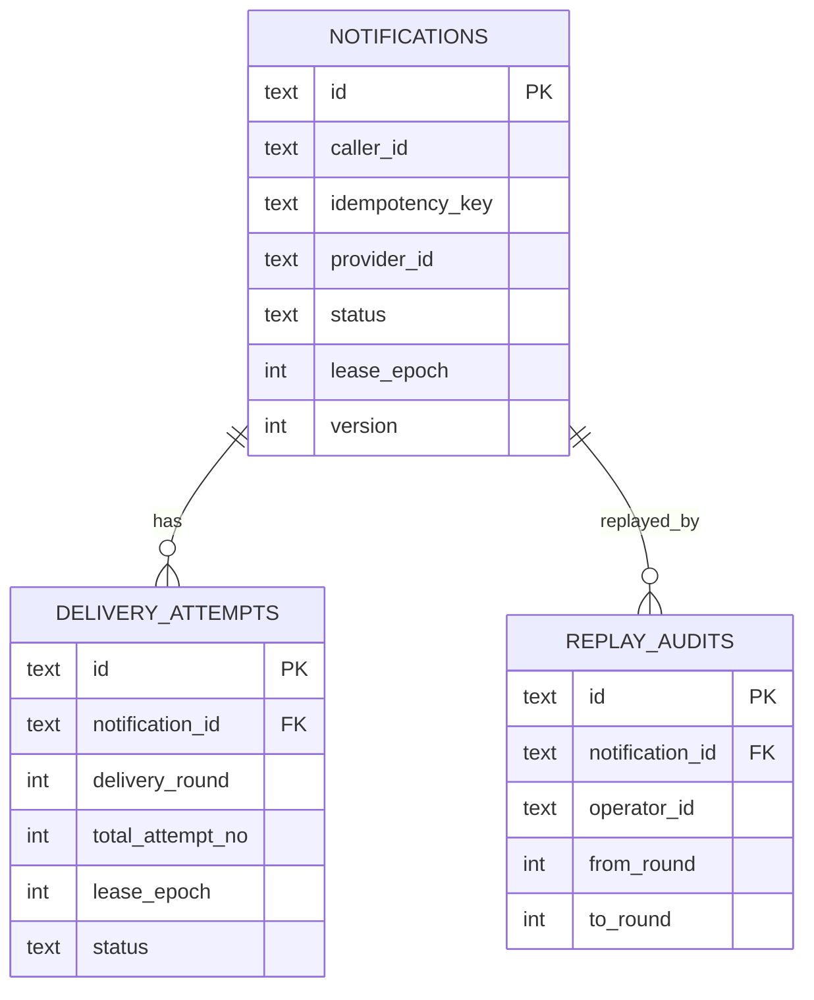

# API 通知系统技术方案

> 文档状态：Draft v0.1，待审查
> 对应需求：[PRD.md](./PRD.md)
> 项目代号：Reliable HTTP Notifier
> 目标阶段：MVP
> 更新日期：2026-09-27

## 0. 一句话技术本质

**SQLite 保存任务事实，调度器只领取当前有能力立即执行的到期任务，Worker 在事务外调用供应商；每次领取生成新的租约代次，只有当前代次能通过 CAS 写回结果。**

可以把它理解为“带编号取件牌的快递柜”：

1. 包裹先入柜，入柜事务提交后才给调用方回执；
2. 配送员领取时得到一个有过期时间、且代次单调递增的取件牌；
3. 配送过程不占用数据库写锁；
4. 只有持有当前取件牌的配送员能更新最终状态；
5. 配送员失联后，新配送员可在租约过期后重新领取；
6. 旧配送员即使迟到，也不能覆盖新状态；
7. 外部请求可能重复，因此每次投递携带稳定通知 ID，供供应商幂等。

---

## 1. 文档目标

本文将 PRD 的产品约束落成可编码、可测试的技术方案，重点回答：

- 如何保证返回 `202` 前任务已经持久化；
- 如何处理调用方重复提交；
- 如何调度任务且不持锁执行外部 HTTP；
- 如何限制全局和单供应商并发；
- 如何通过 Lease、Fencing Token 和 CAS 防止旧 Worker 覆盖新状态；
- 如何分类失败、退避重试、进入死信和人工 Replay；
- 如何处理请求已发出但结果未知的场景；
- 如何配置不同供应商且避免 SSRF 和凭证泄漏；
- 如何采集接口失败率与投递失败率；
- 为什么 MVP 不引入消息队列，以及何时应该演进。

本文不开始编码，也不作为最终实现计划。文档经审查确认后，再拆分实现步骤。

---

## 2. 约束与假设

### 2.1 来自 PRD 的强约束

- 接入 API 不等待供应商响应；
- 只有任务持久化成功后才能返回 `202`；
- 投递语义为 At-least-once；
- 幂等范围为 `caller_id + idempotency_key`；
- 支持不同 Provider 的 URL、Header、鉴权、Body 和成功规则；
- 临时错误有限重试，永久错误或重试耗尽进入死信；
- 支持状态查询和 Replay；
- 服务重启后恢复未完成任务；
- P0 包含全局及 Provider 级并发保护；
- P0 包含服务端事件优先级和等待老化；
- P0 包含结构化日志和基础指标；
- 调用方不能提交任意目标 URL。

### 2.2 MVP 技术假设

| 项目 | 选择 |
|---|---|
| 语言 | Go 1.25+ |
| HTTP Server | 标准库 `net/http` |
| 持久化 | SQLite WAL |
| SQLite 驱动 | `modernc.org/sqlite`，避免 CGO |
| 配置 | YAML，密钥通过环境变量注入 |
| ID | ULID |
| 日志 | `log/slog` JSON Handler |
| 指标 | Prometheus Client |
| 部署 | 单二进制、单实例、单持久卷 |
| 调度 | 数据库轮询 + 提交后非阻塞唤醒 |
| 默认 Worker | 10 |
| 事件优先级 | `HIGH/NORMAL/LOW`，服务端映射 |
| 默认 Aging | 每等待 30 秒提升一级有效优先级 |
| 默认请求超时 | 10 秒 |
| 默认租约 | 30 秒 |
| 默认最大尝试 | 每轮 12 次，包含首次 |

### 2.3 明确的运行边界

- SQLite 文件必须位于本地磁盘或具备可靠锁语义的单机持久卷；
- 不通过共享 SQLite 文件实现多实例；
- `50 req/s` 和 `P95 <= 200 ms` 是本地验收基线，不是生产 SLO；
- Provider 配置首版静态加载，修改后重启生效；
- 首版不保证消息顺序；
- 首版不执行跨地域容灾；
- 外部 HTTP 副作用无法被本地数据库事务回滚。

---

## 3. 方案选择

### 3.1 选定方案

采用单进程模块化架构：

```text
HTTP API
  -> SQLite 事务持久化
  -> Scheduler 扫描到期任务
  -> 全局与 Provider 并发许可
  -> Claim + StartAttempt 短事务
  -> Worker 事务外执行 HTTP
  -> Lease Epoch + Version CAS 写回
```

SQLite 同时承担：

- 通知任务事实源；
- 待投递任务索引；
- 状态机持久化；
- 投递尝试与 Replay 审计。

内存组件只承担：

- Wake Signal；
- Worker 并发许可；
- Provider 并发许可；
- 调度公平游标；
- 指标聚合；
- P1 令牌桶。

任何内存状态丢失都不能导致已受理任务丢失。

### 3.2 为什么不是 PostgreSQL

PostgreSQL 更适合多实例、在线扩容和高并发领取，但 MVP 没有这些前提。当前使用 PostgreSQL 会增加：

- 本地和评审环境依赖；
- 初始化、连接和生命周期管理；
- 部署失败面；
- 与核心可靠性无关的运维工作。

SQLite 已足以验证事务提交边界、幂等约束、状态机、租约、CAS 和崩溃恢复。方案通过 Repository 接口隔离数据库细节，为后续迁移保留边界。

### 3.3 为什么不是 MQ

MQ 不会自动解决可靠性，只会把问题变长：

```text
业务请求
-> 数据库任务
-> Outbox
-> Relay
-> MQ
-> Consumer
-> 外部 HTTP
-> 数据库结果
```

如果直接“写数据库 + 发 MQ”，会产生双写窗口；若采用 Outbox，则需要额外实现 Relay、发布确认、消费幂等、MQ 重投和通知重试的协同。

在当前吞吐和单实例目标下，MQ 没有提供足以抵消复杂度的收益。因此首版不引入，未来在数据库轮询或单机吞吐成为真实瓶颈时再演进。

### 3.4 为什么不使用通用调度框架

任务调度只需要“按时间领取一条持久任务”，没有 DAG、Cron 编排或工作流补偿需求。引入通用调度框架会重复维护任务状态，并增加框架状态与业务状态的一致性问题。

首版采用可注入时钟的轻量调度循环，状态仍以 SQLite 为准。

---

## 4. 正确性目标与不变量

正确性优先级：

1. 已确认受理的任务不能静默丢失；
2. 旧 Worker 不能覆盖新 Worker 的结果；
3. 每次真实 HTTP 调用必须留下证据；
4. 失败必须有界、可追踪、可恢复；
5. 尽量减少重复，但不以丢任务换取“不重复”；
6. 在正确性成立后再优化吞吐。

必须保持以下不变量：

1. **受理不变量**：任务事务提交成功后才返回 `202`。
2. **幂等不变量**：同一 `caller_id + idempotency_key` 只对应一个逻辑任务。
3. **内容不变量**：同一幂等键不能静默接受不同有效请求。
4. **调度不变量**：只有到期的 `PENDING/RETRY_WAIT` 可被正常领取。
5. **租约不变量**：`DELIVERING` 必须同时存在 owner、epoch 和 deadline。
6. **栅栏不变量**：只有当前 `lease_epoch + version` 能完成状态写回。
7. **终态不变量**：`SUCCEEDED/DEAD` 不被普通调度器领取。
8. **尝试不变量**：每次开始真实 HTTP 前，先持久化唯一 Attempt。
9. **事务不变量**：外部 HTTP 永远不在数据库事务内执行。
10. **恢复不变量**：租约过期只改变状态，不删除任务。
11. **敏感信息不变量**：凭证不进入任务、Attempt、日志和查询响应。
12. **资源不变量**：在途请求不超过全局和 Provider 并发上限。
13. **优先级不变量**：优先级由服务端决定并持久化，调用方不能自报。
14. **防饥饿不变量**：持续到期等待会提高有效优先级，低优任务不会永久失去执行机会。

---

## 5. 总体架构



### 5.1 进程内平面

**接入平面**

- HTTP 路由、认证、限长和严格 JSON 解析；
- 调用 Application Service；
- 不调用供应商。

**调度平面**

- 周期扫描和 Wake Signal；
- 回收过期租约；
- 按 Provider 公平选择到期任务；
- 在 Claim 前预留全局和 Provider 并发许可。

**执行平面**

- 加载已固定版本的 Provider 配置；
- 构造请求并执行 HTTP；
- 分类结果并计算重试；
- 使用 CAS 写回。

三者同进程部署但接口分离，未来可拆成 API、Scheduler 和 Worker。

### 5.2 主链路



---

## 6. 模块边界

建议目录：

```text
.
├── cmd/
│   ├── notifier/
│   │   └── main.go
│   └── mock-provider/
│       └── main.go
├── configs/
│   ├── config.example.yaml
│   └── config.recovery.yaml
├── docs/
│   ├── PRD.md
│   └── TECHNICAL_DESIGN.md
├── internal/notifier/
│   ├── config.go
│   ├── model.go
│   ├── store.go
│   ├── service.go
│   ├── scheduler.go
│   ├── delivery.go
│   ├── provider.go
│   ├── httpapi.go
│   ├── auth.go
│   └── metrics.go
├── scripts/
│   ├── demo.sh
│   ├── recovery-demo.sh
│   └── benchmark.sh
├── AI_USAGE.md
├── Makefile
└── README.md
```

| 模块 | 单一职责 |
|---|---|
| `config` | 加载、解析、密钥注入和启动校验 |
| `model` | 状态、错误类别、任务和 Attempt 数据结构 |
| `store` | SQLite Schema、事务和 CAS |
| `service` | 创建、查询、Replay 用例编排 |
| `scheduler` | 到期扫描、租约恢复和并发许可 |
| `provider` | Provider Registry、Body/Header 适配 |
| `delivery` | HTTP 执行、结果分类和重试计算 |
| `httpapi` | 协议校验、鉴权上下文和错误映射 |
| `metrics` | 低基数指标及 Prometheus 暴露 |

关键接口：

```go
type Store interface {
    CreateOrGet(ctx context.Context, in CreateNotification) (CreateResult, error)
    Get(ctx context.Context, id string) (Notification, error)
    ListDueProviders(ctx context.Context, now time.Time, limit int) ([]string, error)
    ClaimAndStart(ctx context.Context, in ClaimRequest) (ClaimedNotification, error)
    Complete(ctx context.Context, in CompleteRequest) error
    RecoverExpired(ctx context.Context, now time.Time, limit int) (int, error)
    ReplayDead(ctx context.Context, in ReplayRequest) (Notification, error)
}

type Deliverer interface {
    Deliver(ctx context.Context, task ClaimedNotification) DeliveryOutcome
}

type Clock interface {
    Now() time.Time
}
```

接口按业务能力定义，不泄漏 SQL 行结构。时钟和随机源可注入，以便稳定测试退避与租约。

---

## 7. 状态机

### 7.1 状态

| 状态 | 含义 | 普通调度可领取 |
|---|---|---:|
| `PENDING` | 等待首次或恢复后投递 | 是 |
| `DELIVERING` | 已领取且租约有效 | 否 |
| `RETRY_WAIT` | 等待下次重试 | 到期后是 |
| `SUCCEEDED` | 收到成功响应 | 否 |
| `DEAD` | 自动处理结束 | 否 |

### 7.2 转换



状态转换只能由 Store 的语义方法执行，不提供任意 `UpdateStatus`。

### 7.3 投递轮次和尝试次数

- `delivery_round`：首次为 1，每次 Replay 加 1；
- `attempt_in_round`：当前轮真实 HTTP 尝试次数；
- `total_attempt_count`：任务生命周期累计尝试次数；
- Claim 成功但尚未创建 Attempt 的过程不算真实尝试；
- `ClaimAndStart` 提交后即算一次尝试；
- 租约过期且存在 `STARTED` Attempt 时，该尝试标记为 `ABANDONED`，并视为结果未知。

所有已开始的尝试共享每轮最大尝试上限，避免持续崩溃或持续超时导致无限自动投递。

---

## 8. 数据模型

### 8.1 实体关系



### 8.2 `notifications`

```sql
CREATE TABLE notifications (
    id                     TEXT PRIMARY KEY,
    request_id             TEXT NOT NULL,
    caller_id              TEXT NOT NULL,
    idempotency_key        TEXT NOT NULL,
    request_hash           TEXT NOT NULL,
    request_hash_version   INTEGER NOT NULL,
    provider_id            TEXT NOT NULL,
    event_type             TEXT NOT NULL,
    priority               INTEGER NOT NULL DEFAULT 2 CHECK (priority IN (1,2,3)),
    occurred_at_ms         INTEGER NOT NULL,
    payload_json           TEXT NOT NULL CHECK (json_valid(payload_json)),
    status                 TEXT NOT NULL CHECK (
        status IN ('PENDING','DELIVERING','RETRY_WAIT','SUCCEEDED','DEAD')
    ),
    delivery_round         INTEGER NOT NULL DEFAULT 1 CHECK (delivery_round >= 1),
    attempt_in_round       INTEGER NOT NULL DEFAULT 0 CHECK (attempt_in_round >= 0),
    total_attempt_count    INTEGER NOT NULL DEFAULT 0 CHECK (total_attempt_count >= 0),
    max_attempts           INTEGER NOT NULL CHECK (max_attempts >= 1),
    next_attempt_at_ms     INTEGER,
    lease_owner            TEXT,
    lease_epoch            INTEGER NOT NULL DEFAULT 0 CHECK (lease_epoch >= 0),
    lease_until_ms         INTEGER,
    version                INTEGER NOT NULL DEFAULT 0 CHECK (version >= 0),
    last_error_category    TEXT,
    last_http_status       INTEGER,
    last_error_message     TEXT,
    created_at_ms          INTEGER NOT NULL,
    updated_at_ms          INTEGER NOT NULL,
    succeeded_at_ms        INTEGER,
    dead_at_ms             INTEGER,
    UNIQUE (caller_id, idempotency_key),
    CHECK (
        (status = 'DELIVERING'
         AND lease_owner IS NOT NULL
         AND lease_until_ms IS NOT NULL
         AND next_attempt_at_ms IS NULL)
        OR
        (status <> 'DELIVERING'
         AND lease_owner IS NULL
         AND lease_until_ms IS NULL)
    ),
    CHECK (
        (status IN ('PENDING','RETRY_WAIT') AND next_attempt_at_ms IS NOT NULL)
        OR
        (status IN ('DELIVERING','SUCCEEDED','DEAD') AND next_attempt_at_ms IS NULL)
    )
) STRICT;
```

### 8.3 `delivery_attempts`

```sql
CREATE TABLE delivery_attempts (
    id                    TEXT PRIMARY KEY,
    notification_id       TEXT NOT NULL,
    delivery_round        INTEGER NOT NULL,
    attempt_in_round      INTEGER NOT NULL,
    total_attempt_no      INTEGER NOT NULL,
    lease_epoch           INTEGER NOT NULL,
    worker_id             TEXT NOT NULL,
    provider_version      TEXT NOT NULL,
    status                TEXT NOT NULL CHECK (
        status IN ('STARTED','SUCCEEDED','FAILED','ABANDONED')
    ),
    started_at_ms         INTEGER NOT NULL,
    finished_at_ms        INTEGER,
    latency_ms            INTEGER,
    http_status           INTEGER,
    error_category        TEXT,
    error_message         TEXT,
    retryable             INTEGER CHECK (retryable IN (0,1)),
    next_attempt_at_ms    INTEGER,
    FOREIGN KEY (notification_id) REFERENCES notifications(id),
    UNIQUE (notification_id, total_attempt_no),
    UNIQUE (notification_id, lease_epoch)
) STRICT;
```

虽然 PRD 将独立尝试历史列为 P1，本方案建议直接纳入首版。原因是可靠性作业需要证明每次重试和崩溃恢复，单独表的实现成本低于事后补审计能力的迁移成本。

### 8.4 `replay_audits`

```sql
CREATE TABLE replay_audits (
    id                 TEXT PRIMARY KEY,
    notification_id    TEXT NOT NULL,
    operator_id        TEXT NOT NULL,
    reason             TEXT NOT NULL,
    from_round          INTEGER NOT NULL,
    to_round            INTEGER NOT NULL,
    created_at_ms       INTEGER NOT NULL,
    FOREIGN KEY (notification_id) REFERENCES notifications(id),
    UNIQUE (notification_id, to_round)
) STRICT;
```

### 8.5 索引

```sql
CREATE INDEX idx_notifications_due
ON notifications(priority DESC, next_attempt_at_ms, created_at_ms, provider_id)
WHERE status IN ('PENDING','RETRY_WAIT');

CREATE INDEX idx_notifications_expired_lease
ON notifications(lease_until_ms)
WHERE status = 'DELIVERING';

CREATE INDEX idx_notifications_provider_status
ON notifications(provider_id, status, updated_at_ms);

CREATE INDEX idx_attempts_notification
ON delivery_attempts(notification_id, total_attempt_no DESC);
```

### 8.6 数据约定

- 时间统一保存为 UTC Unix 毫秒，API 输出 RFC3339 UTC；
- Payload 保存规范化 JSON；
- `priority` 使用 `LOW=1/NORMAL=2/HIGH=3`，保存创建时的服务端决策；
- `request_hash_version` 为未来规范化算法升级留兼容边界；
- `lease_epoch` 单调递增且不因 Replay 回退；
- `version` 每次任务状态变更递增；
- 错误消息由系统生成、脱敏并截断，不保存外部响应体；
- SQLite Schema 使用显式 migration 版本，旧程序拒绝打开未来版本数据库。

---

## 9. SQLite 事务与运行参数

连接初始化：

```sql
PRAGMA journal_mode = WAL;
PRAGMA synchronous = FULL;
PRAGMA foreign_keys = ON;
PRAGMA busy_timeout = 5000;
```

连接池默认：

```text
MaxOpenConns = 1
MaxIdleConns = 1
ConnMaxLifetime = 0
```

判断依据：

- SQLite 同一时刻只有一个写者；
- 所有写事务都很短；
- 外部 HTTP 不占数据库连接；
- 单连接可降低 `SQLITE_BUSY` 和连接级 PRAGMA 不一致；
- PRD 的 50 req/s 基线远低于该模式的合理上限。

关键写操作使用 `BEGIN IMMEDIATE`：

- 创建或幂等查重；
- Claim + StartAttempt；
- 完成成功或失败；
- 回收过期租约；
- Replay。

数据库文件要求：

- 目录权限默认 `0700`，文件默认 `0600`；
- 容器运行时挂载持久卷；
- 不使用 NFS 等锁语义不可靠的文件系统；
- 启动时检查目录可写；
- 生产使用时增加一致性备份或 SQLite Online Backup。

---

## 10. 接入与幂等

### 10.1 创建流程

```text
1. 认证并得到 caller_id/role
2. 限制 Body 大小
3. 严格解析单个 JSON 对象
4. 校验字段和 Provider
5. 按 event_type 解析服务端优先级
6. 规范化 Payload 和 occurred_at
7. 计算带版本的 request_hash
8. CreateOrGet 短事务并固化优先级
9. COMMIT 成功
10. 非阻塞发送 Wake Signal
11. 返回 202
```

### 10.2 请求规范化

哈希输入：

```text
hash_version
provider_id
event_type
occurred_at_semantics
canonical_payload
```

规则：

- JSON 对象键排序；
- 忽略无意义空白；
- 数字使用 `json.Number`，避免转为 `float64` 后丢精度；
- 数组顺序保留；
- 未提供 `occurred_at` 时，哈希使用固定哨兵值 `server-assigned`；
- 提供时间时转换为 UTC RFC3339Nano；
- 使用 SHA-256。

未提供 `occurred_at` 时，首次创建仍保存服务端当前时间，但重复请求继续使用哨兵参与哈希，避免服务端时间变化造成假冲突。

### 10.3 `CreateOrGet`

事务内先尝试插入：

```sql
INSERT INTO notifications (...)
VALUES (..., 'PENDING', :now, ...)
ON CONFLICT(caller_id, idempotency_key) DO NOTHING;
```

若插入成功，返回新任务。若冲突：

1. 查询原任务；
2. 比较 `request_hash_version` 和 `request_hash`；
3. 相同则返回原任务，`duplicate=true`；
4. 不同则返回 `IDEMPOTENCY_CONFLICT`。

不能只依赖“先查再插”，因为并发请求会穿过检查；数据库唯一约束是最终裁判。

### 10.4 Wake Signal

Wake Channel 容量为 1，发送为非阻塞：

```go
select {
case wakeCh <- struct{}{}:
default:
}
```

Wake 只是降低延迟。即使信号丢失，周期扫描也会发现任务。

---

## 11. 调度与并发隔离

### 11.1 调度触发

- 启动后立即恢复过期租约；
- 默认每 500 ms Tick；
- 新任务提交后发送 Wake；
- 每轮恢复和领取都有批次上限。

### 11.2 为什么 Claim 前预留容量

若先 Claim 大批任务再排入内存队列，租约会在排队期间流逝，可能尚未执行就过期。

因此顺序必须是：

```text
预留全局 Worker 槽位
-> 预留 Provider 槽位
-> Claim + StartAttempt
-> 立即交给 Worker
```

Claim 失败时立即释放两个许可。Worker 完成或放弃时也必须通过 `defer` 释放许可。

### 11.3 服务端优先级

调用方请求不包含 `priority`。服务端配置按 `event_type` 映射：

```yaml
priority:
  default: NORMAL
  aging_interval: 30s
  events:
    payment.succeeded: HIGH
    order.fulfilled: HIGH
    crm.sync: NORMAL
    analytics.report: LOW
```

任务创建时将原始优先级固化到数据库，确保配置变更不会让同一批任务在重启前后改变语义。

调度时计算：

```text
wait = max(0, now - next_attempt_at)
promotion = floor(wait / aging_interval)
effective_priority = min(HIGH, original_priority + promotion)
```

等待从 `next_attempt_at` 开始，而不是从 `created_at` 开始。这样旧任务刚结束重试退避时不会因为创建时间很早而立刻抢占高优任务。

排序规则：

```text
effective_priority DESC
-> next_attempt_at ASC
-> created_at ASC
```

效果：

- HIGH 默认先于 NORMAL 和 LOW；
- NORMAL 等待一个 Aging 周期后可提升为 HIGH；
- LOW 等待两个 Aging 周期后可提升为 HIGH；
- 同一有效优先级下，等待更久者优先；
- 不抢占已经执行中的低优任务。

Aging 表达“越过期越紧急”，避免严格优先队列在持续 HIGH 流量下饿死 LOW。

### 11.4 Provider 公平性

调度器先计算当前最高有效优先级，再查询该级别存在到期任务的 Provider 集合，从上次游标之后轮转：

```text
provider-A -> provider-B -> provider-C -> provider-A
```

对每个 Provider：

1. 尝试取得全局 Worker Semaphore；
2. 尝试取得 Provider Semaphore；
3. 原子领取该 Provider 最早到期的一条任务；
4. 成功后立即启动 Worker；
5. 无任务或 CAS 失败则释放许可。

只有当前最高有效优先级的任务可进入本轮 Provider 轮转。Aging 会让长期等待的低优任务最终进入最高级别。这样同时满足：

- 优先处理关键事件；
- 同优先级下 Provider 之间机会公平；
- 单个慢 Provider 不占满全局 Worker；
- 低优任务不会永久饥饿。

这里只保证调度优先，不保证严格顺序。

### 11.5 未知或禁用 Provider

已有任务引用的 Provider 若在配置中消失或被禁用，不能永久滞留：

- 调度器仍可识别该 Provider 的到期任务；
- 使用一个受全局并发限制的错误处理路径领取任务；
- 将 Attempt 和任务写为 `PROVIDER_CONFIG_ERROR` 与 `DEAD`；
- 记录高优先级日志和指标。

---

## 12. Claim、Lease 与 Fencing

### 12.1 Claim + StartAttempt 事务

在已经预留执行容量后执行：

```sql
BEGIN IMMEDIATE;

SELECT id, version, lease_epoch, attempt_in_round, total_attempt_count
FROM notifications
WHERE provider_id = :provider_id
  AND status IN ('PENDING','RETRY_WAIT')
  AND next_attempt_at_ms <= :now
  AND attempt_in_round < max_attempts
ORDER BY
  MIN(
    3,
    priority + CAST(
      MAX(0, :now - next_attempt_at_ms) / :aging_interval_ms
      AS INTEGER
    )
  ) DESC,
  next_attempt_at_ms ASC,
  created_at_ms ASC
LIMIT 1;

UPDATE notifications
SET status = 'DELIVERING',
    attempt_in_round = attempt_in_round + 1,
    total_attempt_count = total_attempt_count + 1,
    next_attempt_at_ms = NULL,
    lease_owner = :worker_id,
    lease_epoch = lease_epoch + 1,
    lease_until_ms = :lease_until,
    updated_at_ms = :now,
    version = version + 1
WHERE id = :id
  AND version = :old_version
  AND status IN ('PENDING','RETRY_WAIT')
  AND next_attempt_at_ms <= :now
  AND attempt_in_round < max_attempts
RETURNING ...;

INSERT INTO delivery_attempts (...)
VALUES (..., 'STARTED', :now);

COMMIT;
```

UPDATE 影响行数不是 1 时视为竞争失败，不创建 Attempt。

### 12.2 为什么使用 Lease

进程可能在领取后崩溃。永久锁会使任务永远卡住，Lease 则允许超时后重新领取。

Lease 表达的是：

```text
在 deadline 之前，系统暂时承认 owner 的处理权。
```

它不证明 Worker 一定存活，也不证明租约过期后旧 Worker 已停止。

### 12.3 为什么还需要 Epoch 和 Version

场景：

1. Worker A 领取 `epoch=7`；
2. A 长时间停顿，租约过期；
3. Worker B 领取 `epoch=8` 并完成；
4. A 恢复并尝试写回旧结果。

如果只检查任务 ID，A 会覆盖 B。完成写回必须携带：

```text
notification_id
lease_owner
lease_epoch
version
```

写回条件：

```sql
WHERE id = :id
  AND status = 'DELIVERING'
  AND lease_owner = :worker_id
  AND lease_epoch = :lease_epoch
  AND version = :version
```

影响行数必须为 1，否则返回 `STALE_LEASE`，只记录诊断信息，不再修改任务。

`lease_epoch` 表达“第几代持有者”，`version` 表达“读取后任务是否发生任何变化”。两者共同构成本地 Fencing Token。

### 12.4 栅栏边界

本地栅栏只能阻止旧 Worker 覆盖 SQLite，不能撤回已经到达供应商的请求。

因此：

- `lease_epoch + version` 保护本地状态；
- `notification_id` 保护外部幂等协作；
- 超时后的 Provider 查单能力可进一步消歧，但通用 HTTP Provider 并不一定提供该接口。

未来可为支持查询的供应商增加 `Reconciler`：

```text
UNKNOWN
-> 使用 notification_id 查询供应商
-> 已处理：本地补记成功
-> 未处理：重新投递
-> 无法确认：按至少一次策略重试
```

### 12.5 租约时长

启动时必须校验：

```text
lease_duration
>= max_provider_request_timeout
 + finalize_retry_budget
 + safety_margin
```

默认：

```text
max request timeout   = 10s
finalize retry budget = 5s
safety margin         = 5s
lease duration        = 30s
```

MVP 不续租。单次请求已有硬超时，固定租约更容易推理和测试。

---

## 13. HTTP 投递

### 13.1 Provider Registry

启动时将静态配置解析为只读 Registry：

```go
type Provider struct {
    ID         string
    Version    string
    Config     ProviderConfig
    Client     *http.Client
    Semaphore  chan struct{}
}
```

每个 Provider 使用独立 HTTP Transport 和 Semaphore，避免慢连接、连接池或并发额度相互污染。

### 13.2 Body 模式

`passthrough`：

```json
{
  "order_id": "20260927_10001",
  "amount": 19900
}
```

`envelope`：

```json
{
  "notification_id": "ntf_01K...",
  "event_type": "order.paid",
  "occurred_at": "2026-09-27T02:30:00Z",
  "payload": {
    "order_id": "20260927_10001",
    "amount": 19900
  }
}
```

首版不支持任意模板语言。特殊供应商规则通过显式 Adapter 扩展并编写契约测试。

### 13.3 Header 所有权

合成顺序：

1. 系统 Header；
2. Provider 固定 Header；
3. Provider 鉴权 Header；
4. 再次覆盖系统保留 Header，确保配置不能篡改。

系统保留：

```text
Host
Content-Length
Content-Type
User-Agent
Authorization
X-Notification-Id
X-Delivery-Attempt
X-Delivery-Round
X-Request-Id
```

Provider 如需自定义幂等 Header，可配置 Header 名称，但值固定为 `notification_id`。

### 13.4 HTTP Client

每个 Provider 配置：

- Connect Timeout；
- Request Timeout；
- Response Header Timeout；
- Idle Connection Timeout；
- Max Idle Connections；
- 最大响应读取大小。

规则：

- 禁止使用无超时的默认 Client；
- 禁止自动跟随重定向；
- 默认 TLS 1.2+；
- 默认不读取和持久化响应体；
- 非成功响应最多读取有限前缀后丢弃；
- 收到成功状态码后，响应 Body 读取异常不推翻成功判定；
- 关闭 Body，无法安全排空时放弃连接复用。

### 13.5 SSRF 与 DNS Rebinding

防护分两层：

**启动校验**

- URL 必须包含 Scheme 和 Host；
- 生产环境只允许 HTTPS；
- 禁止 URL 中携带用户名和密码；
- 禁止明显的环回、私网、链路本地和元数据地址；
- 禁止配置代理转发。

**连接时校验**

- 自定义 `DialContext` 每次解析域名；
- 检查每个候选 IP；
- 只连接通过策略的 IP；
- 不跟随重定向，防止跳转到内网；
- TLS 校验仍使用原始 Hostname。

开发环境可显式允许 Loopback 和 HTTP，以运行 Mock Provider；生产配置出现这些开关时启动失败。

---

## 14. 结果分类与重试

### 14.1 统一结果

```go
type DeliveryOutcome struct {
    Success       bool
    Category      ErrorCategory
    HTTPStatus    *int
    Retryable     bool
    RetryAfter    *time.Duration
    SafeMessage   string
}
```

`SafeMessage` 必须由系统生成、脱敏并限制长度。

### 14.2 默认分类

| 场景 | Category | Retryable |
|---|---|---:|
| 配置的成功状态码 | `NONE` | 否 |
| DNS 错误 | `DNS_ERROR` | 是 |
| 连接失败 | `CONNECT_ERROR` | 是 |
| 请求已写出后连接中断 | `TRANSPORT_UNKNOWN` | 是 |
| 请求超时 | `TIMEOUT_UNKNOWN` | 是 |
| 停机取消在途请求 | `SHUTDOWN_UNKNOWN` | 是 |
| TLS 证书或主机名错误 | `TLS_CONFIG_ERROR` | 否 |
| 3xx | `UPSTREAM_REDIRECT` | 否 |
| 408 | `UPSTREAM_TIMEOUT` | 是 |
| 425 | `UPSTREAM_TOO_EARLY` | 是 |
| 429 | `RATE_LIMITED` | 是 |
| 500-599 | `UPSTREAM_5XX` | 是 |
| 401/403 | `AUTH_REJECTED` | 否 |
| 其他 400-499 | `UPSTREAM_4XX` | 否 |
| 请求构造失败 | `REQUEST_BUILD_ERROR` | 否 |
| Provider 配置失效 | `PROVIDER_CONFIG_ERROR` | 否 |
| 未分类内部错误 | `INTERNAL_ERROR` | 是 |
| 租约过期 | `LEASE_EXPIRED_UNKNOWN` | 是 |

### 14.3 重试公式

第 `n` 次可重试失败：

```text
base = min(max_delay, initial_delay * 2^(n-1))
delay = base * random(1-jitter_ratio, 1+jitter_ratio)
```

实现时先判断是否接近上限，再乘 2，避免整数溢出。

`Retry-After` 支持整数秒和 HTTP Date：

- 解析失败则忽略；
- 小于最小间隔时提升到最小值；
- 大于最大间隔时截断；
- 仅用于可重试响应。

### 14.4 尝试耗尽

```text
if success:
    SUCCEEDED
else if retryable == false:
    DEAD
else if attempt_in_round >= max_attempts:
    DEAD
else:
    RETRY_WAIT(next_attempt_at)
```

Attempt 在 HTTP 前已经持久化，因此进程崩溃或结果未知也消耗一次尝试。该选择比“未知结果永不计数”更保守，可避免外部持续超时或进程反复崩溃时无限投递。

---

## 15. 结果写回

成功、可重试失败和死信都通过一个短事务完成：

```text
BEGIN IMMEDIATE
-> 按 id + owner + epoch + version CAS 更新 notification
-> 更新对应 STARTED attempt
-> COMMIT
```

成功任务：

```text
status = SUCCEEDED
lease = NULL
next_attempt_at = NULL
succeeded_at = now
```

可重试失败：

```text
status = RETRY_WAIT
lease = NULL
next_attempt_at = now + retry_delay
last_error = classified outcome
```

永久失败或耗尽：

```text
status = DEAD
lease = NULL
next_attempt_at = NULL
dead_at = now
```

任务与 Attempt 必须在同一事务内更新。若 CAS 影响行数为 0：

- 回滚事务；
- 返回 `STALE_LEASE`；
- 增加 stale completion 指标；
- 不覆盖当前权威状态。

如果供应商已返回成功但本地写回暂时失败：

1. 不重复调用供应商；
2. 在租约剩余时间内短暂重试本地完成事务；
3. 超过 `finalize_retry_budget` 后退出；
4. 最终由租约恢复触发重投，因此可能重复但不会静默丢失。

---

## 16. 崩溃恢复

### 16.1 Recovery

启动后立即执行，之后每个 Tick 执行有界批次：

```sql
SELECT id, lease_epoch, version
FROM notifications
WHERE status = 'DELIVERING'
  AND lease_until_ms <= :now
ORDER BY lease_until_ms ASC
LIMIT :limit;
```

对每条任务在同一事务内：

1. 当前 `STARTED` Attempt 更新为 `ABANDONED`；
2. 记录 `LEASE_EXPIRED_UNKNOWN`；
3. 若当前轮尝试已耗尽，任务进入 `DEAD`；
4. 否则任务进入 `PENDING` 且 `next_attempt_at=now`；
5. 清空租约字段；
6. `version + 1`；
7. `lease_epoch` 保持原值，下一次 Claim 再递增。

Recovery 更新同样校验 `id + status + epoch + version + expired deadline`，避免与刚完成的 Worker 冲突。

### 16.2 故障窗口

| 崩溃位置 | 持久状态 | 恢复结果 |
|---|---|---|
| 创建事务提交前 | 无任务 | 调用方重试 |
| 创建提交后、响应前 | `PENDING` | 同幂等键返回原任务 |
| Claim 前 | 待处理 | 下轮继续领取 |
| Claim 提交后、HTTP 前 | `DELIVERING + STARTED` | 过期后重试，旧 Attempt 为 `ABANDONED` |
| 请求发送中 | `DELIVERING + STARTED` | 结果未知，过期后可能重复 |
| 外部成功、写回前 | `DELIVERING + STARTED` | 过期后可能重复，依赖外部幂等 |
| 写回事务未提交 | `DELIVERING + STARTED` | 过期后重试 |
| 成功事务提交后 | `SUCCEEDED` | 不再调度 |

---

## 17. Replay

仅管理员可对 `DEAD` 任务执行：

```text
BEGIN IMMEDIATE
-> 校验当前状态为 DEAD
-> 插入 replay_audits
-> delivery_round += 1
-> attempt_in_round = 0
-> status = PENDING
-> next_attempt_at = now
-> 清理当前错误和终态时间
-> version += 1
-> COMMIT
```

Replay 保留：

- 原 `notification_id`；
- `total_attempt_count`；
- 历史 Attempt；
- 原始 Payload；
- 单调递增的 `lease_epoch`。

Replay 不允许任意修改 Payload。业务内容变化必须使用新的幂等键创建新任务。

---

## 18. API 与认证

### 18.1 路由

| 方法 | 路由 | 权限 | 成功状态 |
|---|---|---|---:|
| POST | `/v1/notifications` | producer/admin | 202 |
| GET | `/v1/notifications/{id}` | owner/admin | 200 |
| POST | `/v1/notifications/{id}/replay` | admin | 202 |
| GET | `/health/live` | 部署策略 | 200 |
| GET | `/health/ready` | 部署策略 | 200/503 |
| GET | `/metrics` | admin 或运维网络 | 200 |

### 18.2 通用协议

- UTF-8 JSON；
- 严格拒绝未知字段和多个 JSON 文档；
- 时间输出为 RFC3339 UTC；
- 接受合法 `X-Request-Id`，否则生成 ULID；
- 所有响应返回 `X-Request-Id`；
- 查询默认不返回 Payload；
- 错误体不包含内部堆栈。

统一错误体：

```json
{
  "error": {
    "code": "IDEMPOTENCY_CONFLICT",
    "message": "idempotency key is already used with different content",
    "request_id": "req_01K..."
  }
}
```

### 18.3 静态 Token

```yaml
auth:
  mode: static_token
  principals:
    - caller_id: order-service
      role: producer
      token_env: ORDER_SERVICE_NOTIFY_TOKEN
    - caller_id: notifier-admin
      role: admin
      token_env: NOTIFIER_ADMIN_TOKEN
```

- Token 从环境变量读取；
- 比较使用 `crypto/subtle.ConstantTimeCompare`；
- `disabled` 仅允许 development 且监听 Loopback；
- 相同 Token 不允许映射到多个身份；
- 生产环境必须启用认证。

---

## 19. 可观测性

### 19.1 日志

关键字段：

```text
timestamp
level
event
request_id
notification_id
caller_id
provider_id
provider_version
delivery_round
attempt_no
lease_epoch
worker_id
status_from
status_to
error_category
http_status
latency_ms
```

关键事件：

```text
notification.accepted
notification.duplicate
notification.idempotency_conflict
delivery.started
delivery.succeeded
delivery.retry_scheduled
delivery.dead
delivery.stale_completion
lease.recovered
notification.replayed
database.operation_failed
config.validation_failed
```

禁止记录：

- 完整 Payload；
- Authorization、Cookie 和 API Key；
- 完整外部响应体；
- Token 环境变量值。

### 19.2 Metrics

采用 Prometheus Client，指标使用低基数标签：

```text
notifier_api_requests_total{route,method,status}
notifier_api_request_duration_seconds{route,method}
notifier_notifications_accepted_total{provider,duplicate}
notifier_notifications_by_status{provider,status}
notifier_oldest_due_age_seconds{provider}
notifier_notifications_claimed_total{provider,priority}
notifier_delivery_attempts_total{provider,outcome,error_category}
notifier_delivery_duration_seconds{provider,outcome}
notifier_retries_scheduled_total{provider,error_category}
notifier_dead_total{provider,error_category}
notifier_lease_recovered_total{provider}
notifier_stale_completion_total{provider}
notifier_workers_in_use
notifier_worker_capacity
notifier_provider_in_flight{provider}
notifier_provider_concurrency_limit{provider}
notifier_database_operation_duration_seconds{operation}
notifier_database_errors_total{operation}
```

不得把 `notification_id`、`caller_id`、URL 或原始错误文本放入指标标签。

接口 5xx 失败率示例：

```promql
sum(rate(notifier_api_requests_total{status=~"5.."}[5m]))
/
clamp_min(sum(rate(notifier_api_requests_total[5m])), 1)
```

Provider 投递失败率示例：

```promql
sum by (provider) (
  rate(notifier_delivery_attempts_total{
    outcome=~"retryable_failure|permanent_failure|unknown"
  }[5m])
)
/
clamp_min(
  sum by (provider) (rate(notifier_delivery_attempts_total[5m])),
  1
)
```

告警同时设置失败率、最小请求量和持续时间，避免低流量单次失败产生噪声。

任务状态和最老到期年龄由后台低频刷新，不在每次 `/metrics` 请求时扫描全表。

### 19.3 建议告警

- API 5xx 率持续升高；
- Provider 失败率持续升高且请求量达到阈值；
- HIGH 任务最老到期年龄持续超过目标；
- LOW 任务等待超过两个 Aging 周期仍未被领取；
- `DEAD` 持续新增；
- 最老到期任务年龄持续增长；
- `AUTH_REJECTED` 出现；
- Worker 长期满载；
- 租约恢复或 stale completion 持续增长；
- SQLite 写错误、磁盘空间不足或 WAL 异常增长。

---

## 20. P1 基础限流

限流不是 P0 正确性前提，但接口边界在首版预留。

建议使用 `golang.org/x/time/rate`：

```yaml
rate_limit:
  ingress:
    enabled: true
    global:
      rate_per_second: 500
      burst: 1000
    per_caller:
      rate_per_second: 50
      burst: 100
  providers:
    crm:
      rate_per_second: 20
      burst: 40
```

接入侧：

- 在访问 SQLite 前执行全局和调用方令牌桶；
- 超限返回 `429 + Retry-After`；
- 重复提交同样受容量保护，但可使用原幂等键安全重试；
- 调用方桶空闲超时后回收，并限制最大桶数量。

投递侧：

- Scheduler 在 Claim 前检查 Provider 令牌；
- 无令牌时不领取任务、不创建 Attempt、不消耗尝试次数；
- 计算最近可用时间，避免固定周期忙轮询；
- 进程重启后令牌桶状态丢失可能产生一次突发，单实例 P1 接受该边界。

多实例后，本地令牌桶不再代表全局配额，应迁移到共享限流服务或按实例切分配额。

---

## 21. 配置

示例：

```yaml
environment: development

server:
  address: "127.0.0.1:8080"
  max_body_bytes: 262144
  shutdown_grace: 15s
  read_header_timeout: 2s
  read_timeout: 5s
  write_timeout: 5s
  idle_timeout: 60s

database:
  path: "./data/notifier.db"
  busy_timeout: 5s

scheduler:
  poll_interval: 500ms
  provider_scan_limit: 100
  recovery_batch_size: 100
  lease_duration: 30s
  finalize_retry_budget: 5s

workers:
  concurrency: 10

priority:
  default: NORMAL
  aging_interval: 30s
  events:
    payment.succeeded: HIGH
    order.fulfilled: HIGH
    crm.sync: NORMAL
    analytics.report: LOW

retry:
  initial_delay: 5s
  max_delay: 6h
  jitter_ratio: 0.2
  default_max_attempts: 12

auth:
  mode: disabled

network_policy:
  allow_insecure_http: true
  allow_private_ip: true

providers:
  crm:
    version: "2026-09-27-v1"
    enabled: true
    method: POST
    url: "http://127.0.0.1:18080/crm"
    body_mode: envelope
    success_status_codes: [200, 202]
    max_response_bytes: 16384
    idempotency_header: "Idempotency-Key"
    auth:
      type: bearer
      token_env: CRM_BEARER_TOKEN
    timeout:
      connect: 3s
      request: 10s
    retry:
      max_attempts: 12
    max_concurrency: 5

  inventory:
    version: "2026-09-27-v1"
    enabled: true
    method: POST
    url: "http://127.0.0.1:18080/inventory"
    body_mode: passthrough
    success_status_codes: [200]
    max_response_bytes: 16384
    auth:
      type: api_key_header
      header: "X-API-Key"
      value_env: INVENTORY_API_KEY
    timeout:
      connect: 2s
      request: 5s
    retry:
      max_attempts: 8
    max_concurrency: 3
```

启动失败条件：

- 配置包含未知字段；
- 环境、认证模式或 Body 模式非法；
- 生产环境关闭认证、允许 HTTP 或允许私网地址；
- Provider ID、URL、Method、Header 或成功码非法；
- 密钥环境变量缺失；
- 超时、并发或最大尝试数不为正；
- 默认优先级、事件优先级或 Aging 周期非法；
- Provider 并发超过全局并发；
- 租约无法覆盖最大请求时长、写回预算和安全余量；
- 数据库目录不可写；
- 数据库 Schema 版本高于当前程序支持版本。

启动日志只输出非敏感配置摘要和配置指纹。

---

## 22. 启动与停机

启动顺序：

```text
加载配置
-> 解析密钥
-> 严格校验
-> 打开 SQLite
-> 检查 Schema 版本并迁移
-> 初始化 Provider Registry
-> 初始化 Metrics
-> 绑定 HTTP Listener
-> 启动 Scheduler
-> 标记 Ready
-> Serve
```

停机顺序：

```text
Ready=false
-> 停止接收新请求
-> 停止 Scheduler 和新 Claim
-> 等待在途 Worker
-> 宽限期到期后取消 Context
-> 关闭空闲 HTTP 连接
-> 关闭数据库
```

被取消的在途请求结果视为未知。未写回任务由租约过期恢复。

`/health/live` 只证明进程可响应；`/health/ready` 检查服务未停机且 SQLite 可在短超时内执行查询。Provider 故障不影响进程存活。

---

## 23. 测试方案

### 23.1 单元测试

- 状态机合法和非法转换；
- 服务端优先级映射，且调用方不能覆盖；
- Aging 边界、封顶和基于 `next_attempt_at` 的计算；
- JSON 规范化及大整数；
- 幂等 Hash 稳定性和版本；
- 重试公式、抖动范围、防溢出；
- `Retry-After` 秒数和 HTTP Date；
- HTTP 状态、DNS、连接、TLS 和超时分类；
- passthrough/envelope Body；
- Header 所有权和凭证注入；
- 静态 Token 常量时间校验；
- 指标标签无高基数字段。

### 23.2 SQLite 集成测试

使用临时目录中的真实 SQLite：

- 创建后查询；
- 同键同内容去重；
- 同键不同内容冲突；
- 并发创建只有一条任务；
- 到期任务可领取，未到期任务不可领取；
- Claim 同时创建唯一 `STARTED` Attempt；
- Provider 并发满时不 Claim；
- HIGH 优先于 NORMAL/LOW；
- LOW 等待老化后最终获得调度；
- 同一有效优先级下 Provider 轮转公平；
- 两次 Claim 不会得到同一有效租约；
- 旧 Epoch/Version 写回被拒绝；
- Task 与 Attempt 同事务成功或失败；
- 过期租约恢复并标记 `ABANDONED`；
- 尝试耗尽进入 `DEAD`；
- Replay 新增审计、增加轮次并保留总次数；
- Schema 约束、索引和 Migration 生效。

### 23.3 HTTP 组件测试

- Body 超限返回 413；
- 非法 JSON、未知字段和多个 JSON 文档返回 400；
- Provider 不存在返回 404；
- 存储提交失败不返回 202；
- 认证失败返回 401/403；
- producer 不能查询他人任务或 Replay；
- 查询和日志不泄露 Payload 与凭证；
- 所有响应包含 Request ID；
- Metrics 可计算 API 和 Provider 失败率。

### 23.4 Mock Provider

提供可编程端点：

```text
/always-200
/fail-twice-then-200
/always-400
/always-503
/rate-limit?retry_after=3
/delay?duration=15s
/record
```

记录通知 ID、尝试序号、必要 Header、Body 和到达时间，用于验证 Provider 格式和重复投递；记录时必须过滤凭证。

### 23.5 进程级故障测试

至少验证：

1. 返回 `202` 后、投递前执行 `kill -9`；
2. 请求到达 Mock 后、本地写回前执行 `kill -9`；
3. 使用同一 SQLite 文件重启；
4. 等待租约过期；
5. 验证 Epoch 增加、旧 Attempt 变为 `ABANDONED`；
6. 验证最终成功；
7. 验证重复请求携带相同通知 ID。

### 23.6 质量门

```text
gofmt check
go vet ./...
go test ./...
go test -race ./...
go build ./cmd/...
demo
recovery-demo
benchmark
```

---

## 24. 性能与容量

接入压测基线：

```text
并发：20
请求数：至少 500
Payload：约 1 KiB
目标吞吐：>= 50 req/s
目标 P95：<= 200 ms
HTTP 202：100%
```

投递理论上限近似：

```text
throughput ~= worker_concurrency / average_provider_latency
```

例如供应商平均延迟 200 ms、并发 10：

```text
10 / 0.2 = 50 attempts/s
```

必须同时观察：

- API P50/P95/P99；
- SQLite 写事务耗时和 Busy 次数；
- Worker 与 Provider 并发；
- 最老到期任务年龄；
- 内存是否随积压线性增长；
- WAL 和数据库文件增长。

出现以下信号时迁移 PostgreSQL：

- 需要多实例高可用；
- 单写者锁等待成为主要延迟；
- 持续流量显著超过单机验证范围；
- 任务和 Attempt 规模使扫描、备份或保留困难；
- 需要在线扩容 Worker。

出现以下信号时引入 Outbox + MQ：

- 数据库轮询成为明确瓶颈；
- 投递吞吐需要独立扩缩容；
- 需要按 Provider 或业务键分区消费；
- 需要跨服务复用可靠事件流；
- 团队已有成熟 MQ 运维、监控和消费治理能力。

---

## 25. 需求映射

| PRD | 技术机制 |
|---|---|
| FR-001 创建通知 | `POST /v1/notifications` + Application Service |
| FR-002 请求校验 | Body 限长 + 严格 JSON + 字段和 Provider 校验 |
| FR-003 持久化后确认 | `CreateOrGet` 提交成功后返回 202 |
| FR-004 幂等提交 | 唯一约束 + Canonical JSON + Versioned SHA-256 |
| FR-005 异步响应 | 接入事务不调用 Provider + Wake Signal |
| FR-101 Provider 配置 | 静态 YAML + 环境变量密钥 + 启动校验 |
| FR-102 Header 与鉴权 | 保留 Header 所有权 + Bearer/API Key |
| FR-103 Body 适配 | Registry + passthrough/envelope |
| FR-104 地址安全 | 配置白名单 + 启动校验 + Safe Dialer |
| FR-201 持久化调度 | Tick + Wake + SQLite 到期索引 |
| FR-202 原子领取 | `BEGIN IMMEDIATE` + 条件 UPDATE |
| FR-203 有界并发 | 全局 Semaphore + Provider Semaphore |
| FR-204 HTTP 资源边界 | 分层超时 + 响应限长 + 并发上限 |
| FR-205 尝试记录 | `delivery_attempts` 与 Task 同事务更新 |
| FR-206 事件优先级 | 服务端映射 + 持久化快照 + Aging |
| FR-301 结果分类 | `DeliveryOutcome` + 稳定错误类别 |
| FR-302 重试 | 指数退避 + 抖动 + Retry-After |
| FR-303 死信 | 永久失败或耗尽转 `DEAD` |
| FR-304 Replay | 原 ID + 新轮次 + 审计事务 |
| FR-401 查询 | Task 当前状态 + 最近 Attempt |
| FR-402 健康检查 | live/ready 分离 |
| FR-403 日志 | `slog` JSON + 字段白名单 |
| FR-404 身份授权 | 静态 Token + caller_id + role |
| FR-405 指标 | Prometheus Counter/Histogram/Gauge |
| FR-406 限流 | P1 `x/time/rate`，Claim 前检查 |
| FR-407 优雅停机 | 停止 Claim + 有界 Drain + 租约恢复 |
| AC-003/010 崩溃恢复 | Lease + Epoch + Version CAS |

---

## 26. 被否决的方案

| 方案 | 否决原因 |
|---|---|
| 接入后直接启动 Goroutine | 进程退出即丢任务 |
| 先返回 202 再异步写库 | 存在虚假受理窗口 |
| 在事务内执行外部 HTTP | 长事务和写锁会被外部延迟放大 |
| 发送前标记成功 | 标记后崩溃会永久丢通知 |
| 只使用 Lease TTL | 旧 Worker 仍可能晚到覆盖 |
| 无限重试 | 放大故障且无法形成运维闭环 |
| 调用方传任意 URL | SSRF、凭证和治理边界失控 |
| 首版引入 MQ | 引入双写、消费确认和双重重试 |
| 通用脚本模板 | 执行安全与版本管理成本过高 |
| 只保留最后错误 | 无法证明重试和崩溃恢复链路 |
| 为优先级引入 Asynq | 需要 Redis，并替换现有任务事实源和状态审计模型 |
| 为优先级引入 River | PostgreSQL 是主要目标，SQLite 支持仍标记为实验性 |
| 为优先级引入 Backlite | SQLite 方向匹配，但公开能力未覆盖本方案的 Aging 和 Fencing 约束 |
| 为优先级引入 Machinery | Broker/Backend 和工作流能力超过当前需求 |

---

## 27. 演进路线

### 27.1 SQLite 到 PostgreSQL

保持领域接口不变，将实现替换为 PostgreSQL：

- 领取使用 `FOR UPDATE SKIP LOCKED`；
- 数据库时间作为 Lease 时间源；
- 多实例使用唯一 `instance_id`；
- Epoch 和 Version CAS 保持不变；
- 指标和日志增加实例维度，但不增加任务 ID 标签。

### 27.2 Outbox + MQ

迁移顺序：

```text
创建任务 + Outbox 同事务
-> Relay 幂等发布
-> MQ 按 Provider/业务键分区
-> Worker 幂等消费
-> SQLite/PostgreSQL 继续保存任务状态和审计
```

MQ 负责传输与削峰，数据库继续作为业务任务事实源。不能把 Broker 中是否存在消息当成最终业务状态。

### 27.3 Provider 查单消歧

对提供查询 API 的供应商增加可选 `Reconciler`：

- 超时或崩溃后优先按通知 ID 查单；
- 已处理则补记成功；
- 明确未处理才重投；
- 查询仍不确定时回到至少一次策略。

这是降低重复副作用的增强，不改变基础投递语义。

### 27.4 顺序投递

只有业务提出明确顺序需求时才增加：

- `partition_key`；
- 同分区单 Worker；
- 单调业务序号；
- 前序阻塞、超时和死信策略。

### 27.5 开源任务框架调研

调研日期：2026-09-27。

| 项目 | 已有能力 | 不直接采用的原因 | 适用时机 |
|---|---|---|---|
| [Asynq](https://github.com/hibiken/asynq) | Redis 持久队列、重试、崩溃恢复、加权/严格优先队列、Web UI | 引入 Redis；优先级按多队列表达；业务状态、Replay 审计和本地 CAS 仍需整合；主版本仍为 `v0` | 已有 Redis，且需要多机 Worker 和队列运维能力 |
| [River](https://github.com/riverqueue/river) | 数据库任务、重试、唯一任务、整数优先级、多实例 | PostgreSQL 是主要目标；严格优先级可能使低优任务饥饿；SQLite 支持仍为实验性 | 系统迁移 PostgreSQL 并需要成熟多实例任务队列 |
| [Backlite](https://github.com/mikestefanello/backlite) | 嵌入式 SQLite、持久化、重试、延迟任务、Worker 池 | 方向相近，但公开文档未覆盖优先级 Aging、Epoch Fencing 和本项目审计语义；生态体量较小 | 通用后台任务且无需本项目定制状态机 |
| [Machinery](https://github.com/RichardKnop/machinery) | Redis/AMQP/SQS 等 Broker、重试、工作流 | 需要额外 Broker/Backend，工作流能力明显超出本需求 | 已有消息基础设施且任务编排复杂 |

结论：不引入完整任务框架。优先级是本项目领域调度规则，使用一个持久化整数、一个可测试的 Aging 函数和带索引的领取查询即可实现。外部框架会扩大部署与一致性边界，却不能替代通知任务自身的幂等、审计和 Provider 语义。

---

## 28. 风险与缓解

| 风险 | 影响 | 缓解 |
|---|---|---|
| SQLite 单写者 | 写延迟上升 | 短事务、单连接、压测、达到阈值迁移 |
| 文件或磁盘损坏 | 任务不可用 | 持久卷、FULL 同步、备份、磁盘告警 |
| 外部重复副作用 | 业务重复 | 稳定通知 ID、供应商幂等、未来查单 |
| 租约设置过短 | 无意义重复领取 | 启动校验超时预算 |
| Provider 长时间故障 | Worker 被占满 | Provider Semaphore、退避、死信 |
| 高优任务持续涌入 | 低优任务饥饿 | 基于到期等待时间的 Aging |
| 调用方滥用 HIGH | 优先级失效 | 仅服务端按事件类型映射并持久化 |
| DNS Rebinding | SSRF 绕过 | 每次 Dial 校验解析结果、禁重定向 |
| Payload 含敏感信息 | 数据泄漏 | 不记录 Payload、文件权限、后续加密与保留策略 |
| 指标高基数 | 监控系统压力 | 标签白名单，禁止任务 ID、Caller ID 和原始错误 |
| 配置删除 Provider | 任务永久滞留 | 缺失配置任务进入 DEAD 并告警 |
| 系统时钟跳变 | Lease 或重试偏差 | 单实例统一 Clock；多实例后使用数据库时间 |

---

## 29. 审查重点

本方案建议重点确认：

1. 是否接受 SQLite 仅支持单实例的明确边界；
2. 是否接受 Attempt 在 HTTP 前持久化，崩溃后的未知尝试消耗重试额度；
3. 是否接受独立 Attempt 历史从 P1 提前纳入实现；
4. Provider 并发许可是否应在首版支持；
5. P1 令牌桶是否在本次实际实现，还是只保留设计；
6. 是否接受通用 Provider 只能用稳定通知 ID 缓解重复，无法统一查单；
7. 是否接受 `HIGH/NORMAL/LOW + 30s Aging` 的优先级模型；
8. 默认参数是否符合演示时间和评审环境。

---

## 30. 技术方案完成定义

满足以下条件后可进入实现计划阶段：

- PRD P0 均有明确技术承接；
- 接入事务、Claim、HTTP 和写回事务边界无歧义；
- Lease、Epoch、Version CAS 的职责和边界已确认；
- 状态机与数据库约束一致；
- Provider 并发保护和指标方案已确认；
- 安全边界和敏感信息规则已确认；
- 故障窗口均有恢复结果；
- SQLite、PostgreSQL 和 MQ 的取舍依据明确；
- 测试能够验证关键不变量；
- 用户完成技术方案审查。

本文档审查通过前不提交 Git，也不开始编码。
